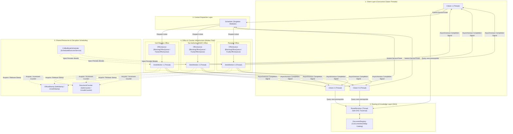
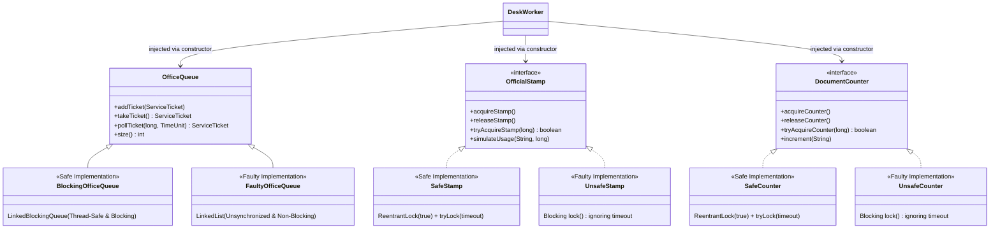
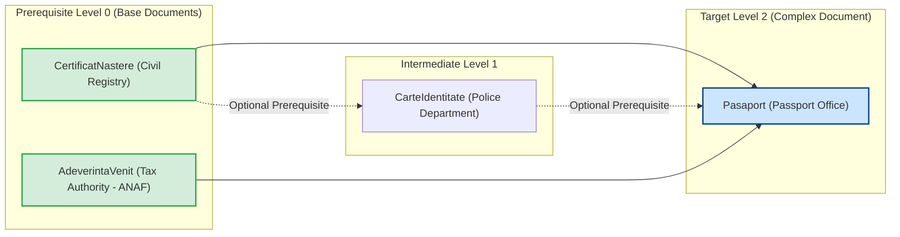
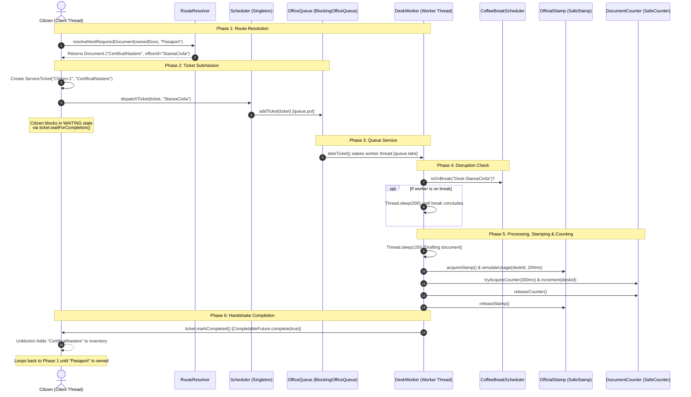
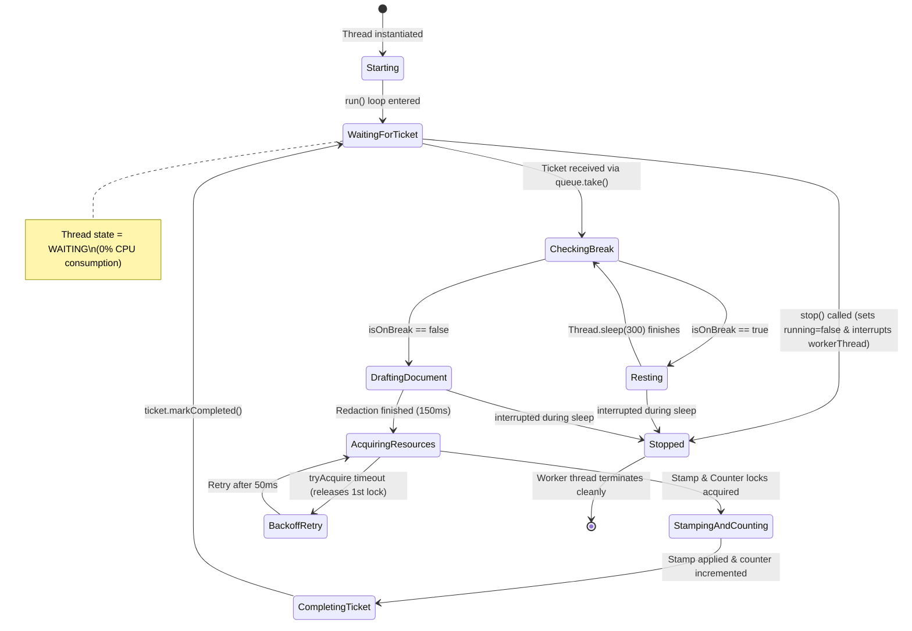
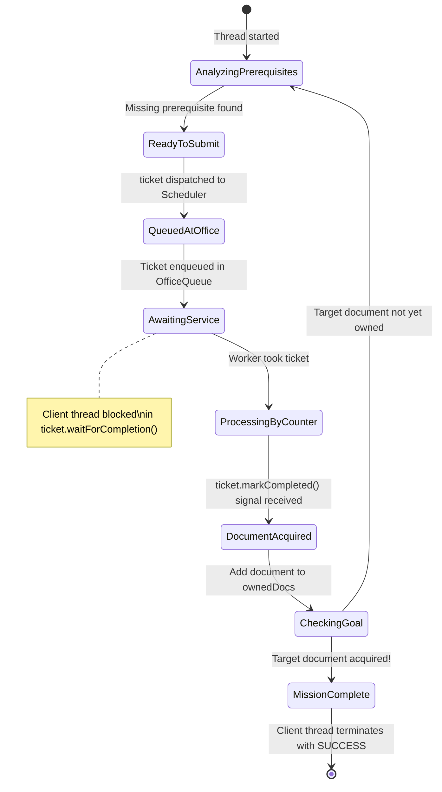
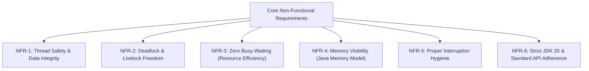
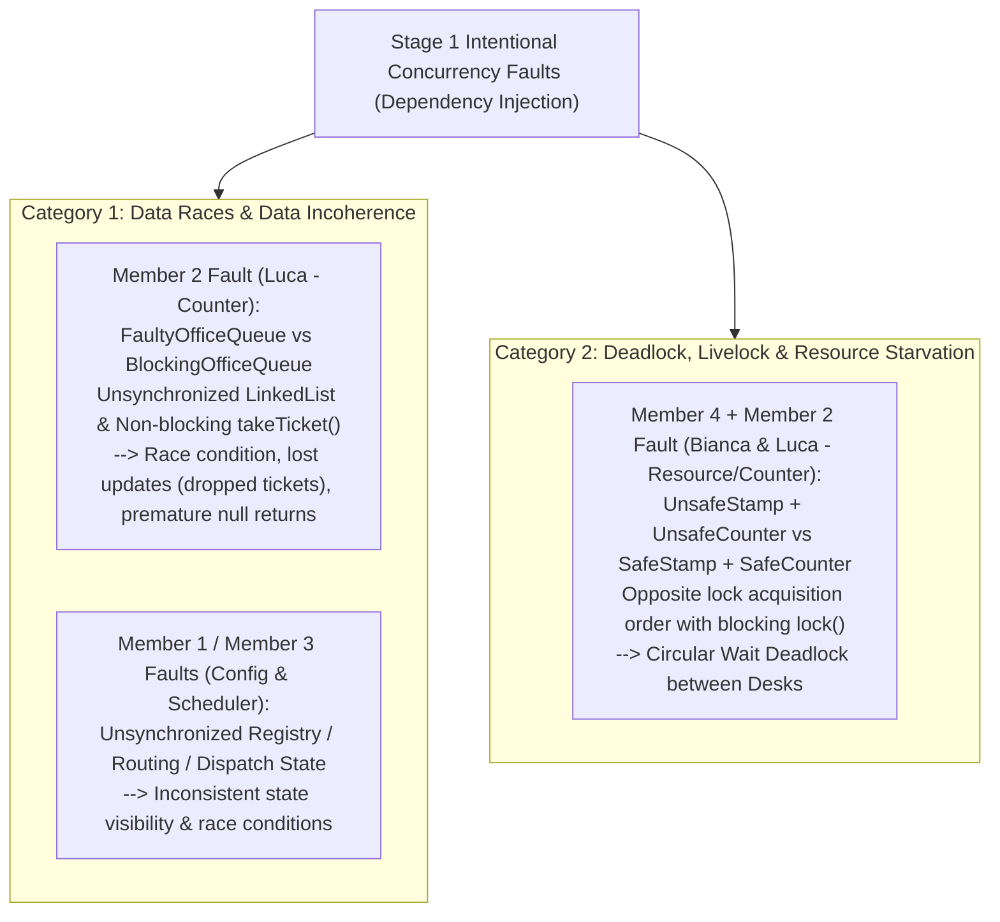
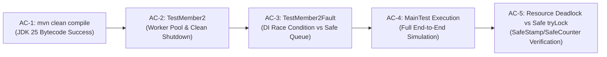

# Project Requirements Specification: Bureaucracy System Coordinator

**Course:** Concurrent and Event-Based Programming (CEBP / PCBE) — Year 4, Semester 1 (2026/2027)  
**Institution:** Politehnica University of Timișoara (UPT)  
**Project Topic:** Bureaucratic System Coordinator (_Coordonator de Sistem Birocratic_)  
**Target Environment:** Java SE 25 LTS, Apache Maven, Standard `java.util.concurrent` API

---

## 1. Project Overview & Objectives

The **Bureaucracy System Coordinator** is a multi-threaded Java simulation that models citizen navigation through an administrative institution with interdependent documents, multi-counter waiting queues, shared institutional resources, and stochastic service disruptions (coffee breaks).

In accordance with **Stage 1** laboratory requirements, the system provides:
1. **A Complete, Thread-Safe Working Solution:** Built exclusively with standard `java.util.concurrent` primitives (`LinkedBlockingQueue`, `ConcurrentHashMap`, `CompletableFuture`, `ReentrantLock(true)`, `ScheduledExecutorService`, `AtomicBoolean`, and `volatile` state flags).
2. **Intentional Concurrency Fault Implementations via Dependency Injection:** Each module exposes an abstraction (interface or base class) with two interchangeable implementations—a **Safe (Good)** implementation and a **Faulty (Bad)** implementation—allowing deterministic demonstration of **Data Races / State Corruption** and **Deadlock / Livelock / Starvation**.

---

## 2. High-Level Architecture & Component Map

The system is organized into 5 modular layers communicating via thread-safe abstractions and Dependency Injection:

---

## 3. Team Responsibilities & Ownership Matrix

| Team Member            | Module & Package                          | Key Components                                                                                                   | Concurrency Primitives & Patterns Utilized                                                                                     |
| :--------------------- | :---------------------------------------- | :--------------------------------------------------------------------------------------------------------------- | :----------------------------------------------------------------------------------------------------------------------------- |
| **Member 1 (Tatiana)** | `bureaucraticSystem.config`               | `Document`, `DocumentRegistry`, `RouteResolver`                                                                  | `ConcurrentHashMap`, defensive immutable `Set.copyOf`, recursive DAG cycle detection                                           |
| **Member 2 (Luca)**    | `bureaucraticSystem.counter`              | `OfficeQueue`, `BlockingOfficeQueue`, `FaultyOfficeQueue`, `DeskWorker`, `TestMember2`, `TestMember2Fault`       | `LinkedBlockingQueue` (Producer-Consumer), Dependency Injection, `volatile` thread interruption & visibility, Worker Pool      |
| **Member 3 (Vlad)**    | `bureaucraticSystem.client` & `scheduler` | `Client`, `ServiceTicket`, `Scheduler`                                                                           | `CompletableFuture<Boolean>` async handshake, `ConcurrentHashMap.newKeySet()`, Double-Checked Locking Singleton                |
| **Member 4 (Bianca)**  | `bureaucraticSystem.resource`             | `OfficialStamp`, `SafeStamp`, `UnsafeStamp`, `DocumentCounter`, `SafeCounter`, `UnsafeCounter`, `CoffeeBreakScheduler` | Fair `ReentrantLock(true)`, `tryLock(timeout)` deadlock avoidance vs blocking `lock()` circular wait, `ScheduledExecutorService` |

---

## 4. Dependency Injection Architecture (Safe vs. Faulty Implementations)

To cleanly isolate intentional concurrency faults from the working solution without duplicating business logic, components rely on polymorphic Dependency Injection:

---

## 5. Document Dependency Graph (DAG) Model

Documents cannot be obtained directly. Prerequisite relationships form a Directed Acyclic Graph:

---

## 6. Functional Requirements (FR)

### FR-1: Document & Catalog Management

- **FR-1.1:** The system shall define administrative documents as immutable objects (`Document`) containing:
  - Unique document ID (`String`)
  - Issuing office ID (`String`)
  - Immutable set of prerequisite document IDs (`Set<String>`)
- **FR-1.2:** The system shall maintain an in-memory catalog (`DocumentRegistry`) backed by a `ConcurrentHashMap` supporting concurrent insertions and thread-safe lock-free reads.
- **FR-1.3:** The system shall support dynamic registration of an arbitrary number of offices and documents.

### FR-2: Dependency Graph & Route Resolution

- **FR-2.1:** Given a client's currently owned document inventory and a designated target document, `RouteResolver` shall inspect the DAG and compute the immediate next prerequisite document that the client does not possess.
- **FR-2.2:** If a missing prerequisite itself has unmet prerequisites, the resolution shall recursively traverse deeper until a base document with zero prerequisites (or all prerequisites satisfied) is identified.
- **FR-2.3:** Route resolution shall be completely thread-safe, re-entrant, and read-only, detecting circular dependencies (`IllegalStateException`) without infinite recursion.

### FR-3: Office Waiting Lines & Buffering

- **FR-3.1:** Each administrative office shall have an associated queue (`OfficeQueue` / `BlockingOfficeQueue`).
- **FR-3.2:** The waiting line shall implement FIFO (First-In, First-Out) ordering for submitted `ServiceTicket` instances.
- **FR-3.3:** Adding a ticket (`addTicket`) shall never corrupt internal pointers when executed concurrently by multiple client threads.
- **FR-3.4:** Extracting a ticket (`takeTicket`) shall block if the queue is empty, placing the consuming counter thread in a zero-CPU `WAITING` state until a ticket arrives.

### FR-4: Desk Workers & Service Counters

- **FR-4.1:** Each service counter within an office shall run on an independent thread (`DeskWorker`).
- **FR-4.2:** Multiple desk workers within the same office shall concurrently pull and service tickets from the single shared `OfficeQueue` without duplicate processing.
- **FR-4.3:** Desk workers shall process tickets through distinct phases:
  1. Check and wait for active coffee breaks to conclude.
  2. Simulate administrative validation and drafting (`Thread.sleep`).
  3. Acquire exclusive access to institutional resources (`OfficialStamp` and `DocumentCounter`).
  4. Signal the client that the document is complete (`ticket.markCompleted()`).
- **FR-4.4:** Calling `worker.stop()` shall set the `volatile boolean running` flag to `false` and automatically interrupt the worker thread (`workerThread.interrupt()`) to wake it immediately if blocked in `queue.takeTicket()`.

### FR-5: Client Request Lifecycle & Autonomous Progress

- **FR-5.1:** Each citizen shall be represented by an independent concurrent thread (`Client`).
- **FR-5.2:** Clients shall autonomously iterate through the bureaucratic pipeline until their final target document is obtained.
- **FR-5.3:** Communication between clients and desks shall occur via an asynchronous ticket handshake (`ServiceTicket`) containing a `CompletableFuture<Boolean>`.
- **FR-5.4:** The client thread must block efficiently (`waitForCompletion()`) without CPU polling while its ticket is being serviced.

### FR-6: Shared Institutional Resources (`OfficialStamp` & `DocumentCounter`)

- **FR-6.1:** The institution shall feature shared resources (`OfficialStamp` and `DocumentCounter`) accessed across counters via Dependency Injection.
- **FR-6.2:** Safe implementations (`SafeStamp`, `SafeCounter`) shall use fair locks (`ReentrantLock(true)`) and timed acquisition (`tryLock(timeout, TimeUnit.MILLISECONDS)`) with lock release backoff to prevent both starvation and circular-wait deadlocks.

### FR-7: Stochastic Disruptions (Coffee Breaks)

- **FR-7.1:** The system shall support spontaneous coffee breaks managed by `CoffeeBreakScheduler`.
- **FR-7.2:** Breaks shall be triggered periodically using a `ScheduledExecutorService`.
- **FR-7.3:** Desk break statuses shall be stored in a `ConcurrentHashMap<String, AtomicBoolean>`. When on break, a desk shall pause ticket service until the break duration elapses.

### FR-8: Central Request Dispatching

- **FR-8.1:** A central `Scheduler` (implemented as a thread-safe Singleton with Double-Checked Locking) shall mediate ticket submissions from clients to the appropriate `OfficeQueue`.

### FR-9: Graceful Shutdown

- **FR-9.1:** The application shall join all client threads, invoke `stop()` on desk workers (which self-interrupts waiting worker threads), shut down executor services, and exit cleanly without orphaned threads.

---

## 7. End-to-End Sequence of Execution

The following sequence diagram details the complete concurrent handshake across all 5 system layers:

---

## 8. State Machine Models

### Desk Worker Lifecycle:

### Client Thread Lifecycle:

---

## 9. Non-Functional & Concurrency Requirements (NFR)

- **NFR-1 (Thread Safety):** All shared state (`DocumentRegistry`, `BlockingOfficeQueue`, `CoffeeBreakScheduler`, `SafeStamp`, `SafeCounter`) must be thread-safe under unrestricted concurrent read/write operations.
- **NFR-2 (Deadlock Freedom):** When multiple locks (`OfficialStamp` and `DocumentCounter`) are acquired, safe implementations must use timed lock acquisition (`tryLock`) and release held locks on timeout to break Coffman's Hold-and-Wait and Circular-Wait conditions.
- **NFR-3 (Zero Busy-Waiting):** Threads waiting for work or signals must block using operating-system level thread suspension (`queue.take()`, `future.get()`).
- **NFR-4 (Memory Visibility):** Loop termination flags (`running`) and worker thread references (`workerThread`) must be `volatile`. Shared states must use atomic primitives (`AtomicBoolean`) or explicit locks.
- **NFR-5 (Interruption Hygiene):** When an `InterruptedException` is caught, any in-flight ticket is marked failed (`ticket.markFailed()`) so the client thread never hangs indefinitely, and the interrupt flag is restored via `Thread.currentThread().interrupt()`.
- **NFR-6 (Standard Platform):** Must compile and execute cleanly on Java 25 LTS using Apache Maven with zero external concurrency libraries.

---

## 10. Stage 1 Faulty Solutions (Intentional Concurrency Flaws Catalog)

The laboratory requirements specify implementing intentional concurrency flaws covering both **Data Races / Data Incoherence** and **Deadlock / Performance Issues** using Dependency Injection:

### Detailed Breakdown of Implemented Faults:

#### 1. Member 2 Fault (Luca): `FaultyOfficeQueue` vs. `BlockingOfficeQueue` (Data Race & Non-Blocking Incoherence)
- **Dependency Injection Hierarchy:** Base class `OfficeQueue` extended by `BlockingOfficeQueue` (Safe) and `FaultyOfficeQueue` (Faulty).
- **Fault Mechanism:**
  - Replaces `LinkedBlockingQueue` with an unsynchronized `java.util.LinkedList<ServiceTicket>`.
  - `takeTicket()` checks `if (unsafeList.isEmpty()) return null;` instead of blocking the consumer thread in `WAITING`.
- **Demonstrated Concurrency Failure (`TestMember2Fault`):**
  - When 10 concurrent producer threads insert 100 tickets each (1000 total), concurrent mutations of `LinkedList` node pointers (`last.next`) and `size++` collide across CPU cores, losing tickets silently (*Lost Updates*).
  - Calling `takeTicket()` on an empty queue returns `null` immediately instead of suspending the worker thread.

#### 2. Member 4 & Member 2 Fault (Bianca & Luca): `UnsafeStamp` / `UnsafeCounter` vs. `SafeStamp` / `SafeCounter` (Circular Wait Deadlock)
- **Dependency Injection Hierarchy:**
  - `OfficialStamp` interface implemented by `SafeStamp` (uses `lock.tryLock(timeoutMs, MILLISECONDS)`) and `UnsafeStamp` (ignores timeout and calls blocking `lock.lock()`).
  - `DocumentCounter` interface implemented by `SafeCounter` (uses `lock.tryLock(timeoutMs, MILLISECONDS)`) and `UnsafeCounter` (ignores timeout and calls blocking `lock.lock()`).
- **Fault Mechanism:**
  - Desk 1 (`stampFirst = true`) acquires `OfficialStamp` first and then requests `DocumentCounter`.
  - Desk 2 (`stampFirst = false`) acquires `DocumentCounter` first and then requests `OfficialStamp`.
  - With `UnsafeStamp` and `UnsafeCounter`, both desks hold their first lock and block indefinitely waiting for the second lock (**Coffman Circular Wait Deadlock**).
  - With `SafeStamp` and `SafeCounter`, `tryAcquire` times out after 300ms, the desk releases its first lock in `finally`, backs off for 50ms, and retries—eliminating the deadlock completely.

---

## 11. Verification & Acceptance Criteria (AC)

| Criterion ID | Verification Procedure                | Expected Outcome                                                                                                            |
| :----------- | :------------------------------------ | :-------------------------------------------------------------------------------------------------------------------------- |
| **AC-1**     | Execute `mvn clean compile`           | Zero compiler errors on Java 25.                                                                                            |
| **AC-2**     | Execute `TestMember2` independently   | Worker pool of 2 desks processes 4 concurrent clients on a shared queue; `stop()` wakes and closes both desks cleanly.       |
| **AC-3**     | Execute `TestMember2Fault`            | Demonstrates dropped tickets on `FaultyOfficeQueue` vs 1000/1000 preserved tickets on `BlockingOfficeQueue`.                |
| **AC-4**     | Execute `MainTest` integration suite  | All 3 concurrent citizens acquire prerequisites and obtain final passport under coffee breaks; logs confirm clean shutdown. |
| **AC-5**     | Execute Resource Safe vs Unsafe test  | `SafeStamp` + `SafeCounter` resolves lock contention via `tryLock` timeout backoff; `UnsafeStamp` + `UnsafeCounter` demonstrates deadlock. |
