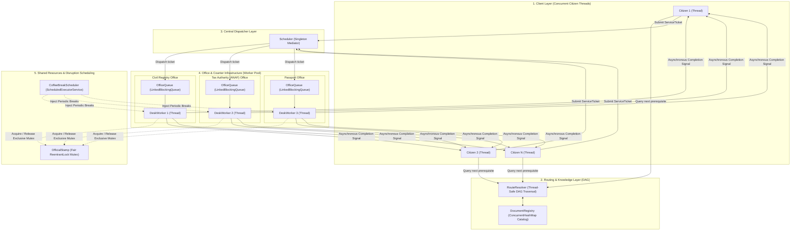
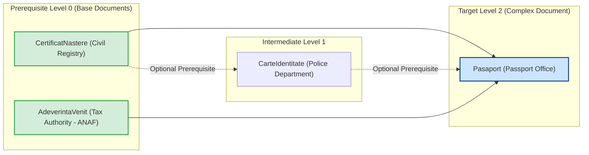
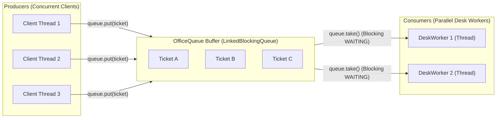
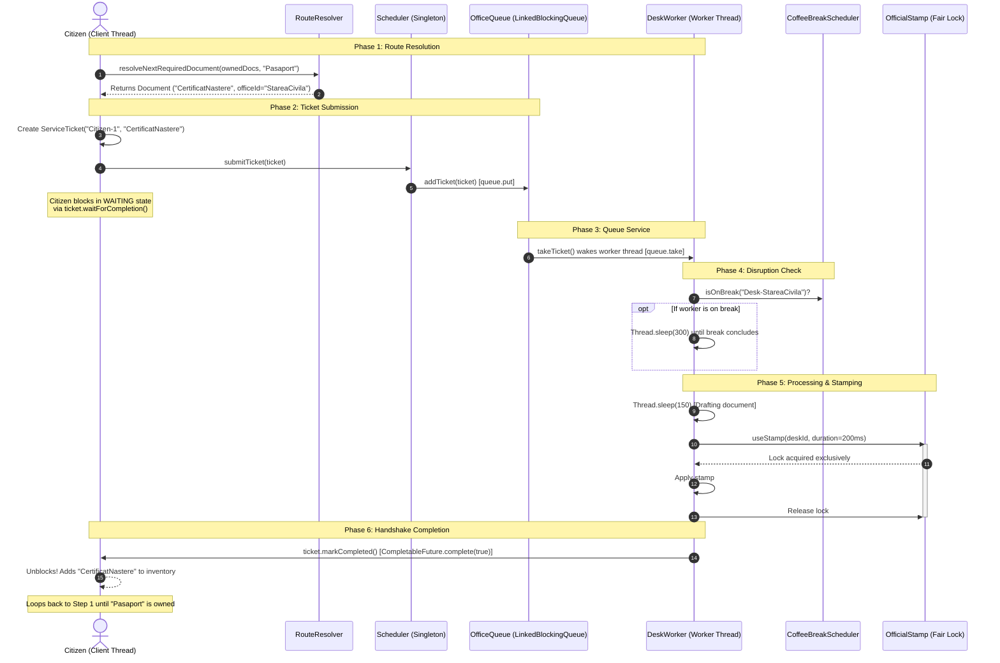
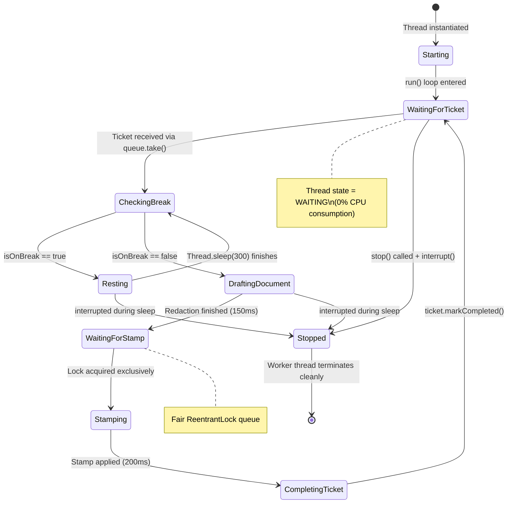
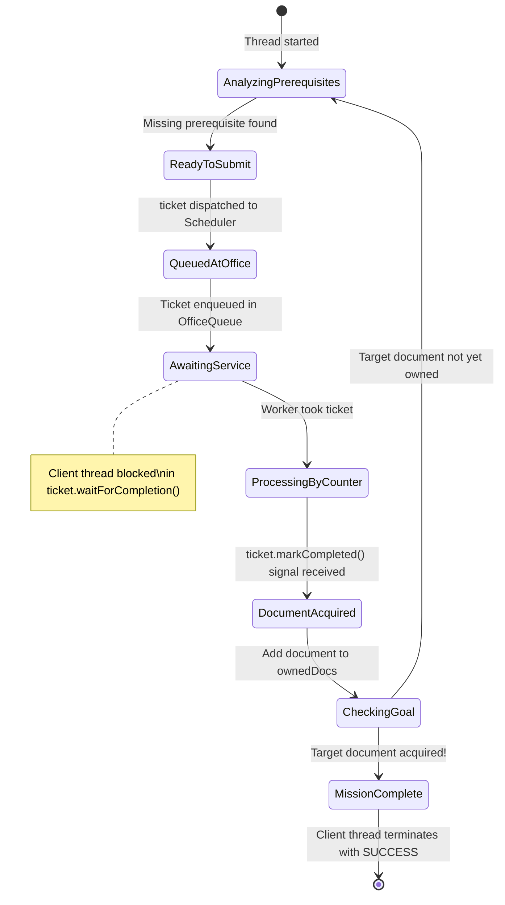
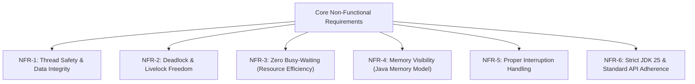
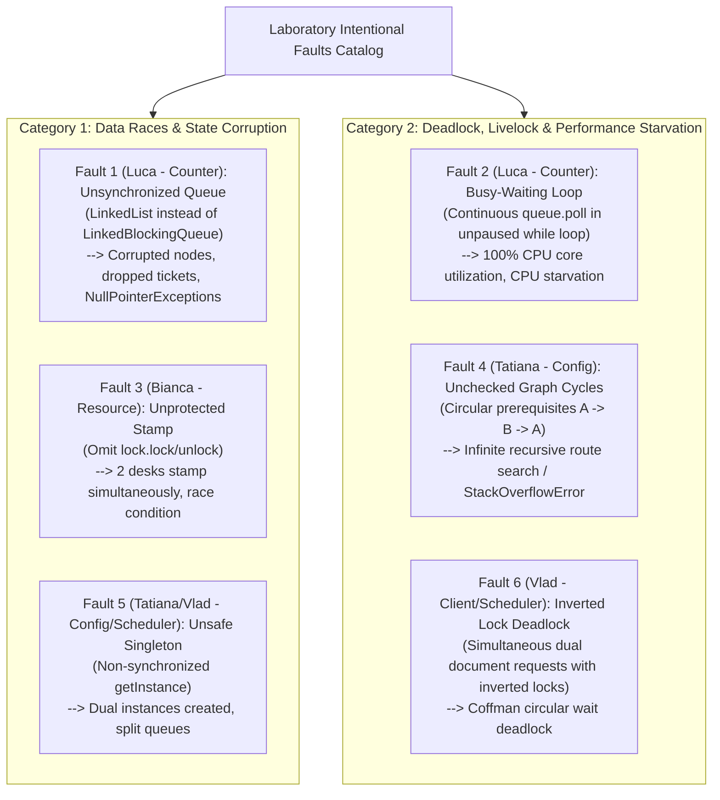
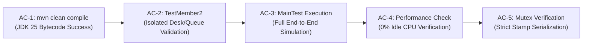

# Project Requirements Specification: Bureaucracy System Coordinator

**Course:** Concurrent and Event-Based Programming (CEBP / PCBE) — Year 4, Semester 1 (2026/2027)  
**Institution:** Politehnica University of Timișoara (UPT)  
**Project Topic:** Bureaucratic System Coordinator (_Coordonator de Sistem Birocratic_)  
**Target Environment:** Java SE 25 LTS, Apache Maven, Standard `java.util.concurrent` API

---

## 2. High-Level Architecture & Component Map

The system is organized into modular components communicating via thread-safe abstractions and standard concurrency primitives:

---

## 3. Team Responsibilities & Ownership Matrix

| Team Member            | Module & Package                          | Key Components                                  | Concurrency Primitives Utilized                                                                          |
| :--------------------- | :---------------------------------------- | :---------------------------------------------- | :------------------------------------------------------------------------------------------------------- |
| **Member 1 (Tatiana)** | `bureaucraticSystem.config`               | `DocumentRegistry`, `RouteResolver`, `Document` | `ConcurrentHashMap`, immutable `Set.copyOf`, DAG cycle detection                                         |
| **Member 2 (Luca)**    | `bureaucraticSystem.counter`              | `OfficeQueue`, `DeskWorker`, `TestMember2`      | `LinkedBlockingQueue` (Producer-Consumer), `volatile` memory visibility, `InterruptedException` handling |
| **Member 3 (Vlad)**    | `bureaucraticSystem.client` & `scheduler` | `Client`, `Scheduler`, `ServiceTicket`          | `CompletableFuture<Boolean>`, thread lifecycles, Double-Checked Locking Singleton                        |
| **Member 4 (Bianca)**  | `bureaucraticSystem.resource`             | `OfficialStamp`, `CoffeeBreakScheduler`         | `ReentrantLock(true)` (fairness lock), `ScheduledExecutorService`, `AtomicBoolean`                       |

---

## 4. Document Dependency Graph (DAG) Model

Documents cannot be obtained directly. Prerequisite relationships form a Directed Acyclic Graph:

---

## 5. Functional Requirements (FR)

### FR-1: Document & Catalog Management

- **FR-1.1:** The system shall define administrative documents as immutable objects (`Document`) containing:
  - Unique document ID (`String`)
  - Issuing office ID (`String`)
  - Immutable set of prerequisite document IDs (`Set<String>`)
- **FR-1.2:** The system shall maintain an in-memory catalog (`DocumentRegistry`) backed by a `ConcurrentHashMap` supporting concurrent insertions and thread-safe lock-free reads.
- **FR-1.3:** The system shall support dynamic registration of an arbitrary number of offices and documents.

### FR-2: Dependency Graph & Route Resolution

- **FR-2.1:** Given a client's currently owned document inventory and a designated target document, `RouteResolver` shall inspect the DAG and compute the immediate next prerequisite document that the client does not possess.
- **FR-2.2:** If a missing prerequisite itself has unmet prerequisites, the resolution shall recursively traverse deeper until a base document with zero prerequisites (or all prerequisites satisfied) is identified.
- **FR-2.3:** Route resolution shall be completely thread-safe, re-entrant, and read-only.

### FR-3: Office Waiting Lines & Buffering

- **FR-3.1:** Each administrative office shall have an associated thread-safe queue (`OfficeQueue`).
- **FR-3.2:** The waiting line shall implement FIFO (First-In, First-Out) ordering for submitted `ServiceTicket` instances.
- **FR-3.3:** Adding a ticket (`addTicket`) shall never corrupt internal pointers when executed concurrently by multiple client threads.
- **FR-3.4:** Extracting a ticket (`takeTicket`) shall block if the queue is empty, placing the consuming counter thread in a zero-CPU `WAITING` state until a ticket arrives.

### FR-4: Desk Workers & Service Counters

- **FR-4.1:** Each service counter within an office shall run on an independent thread (`DeskWorker`).
- **FR-4.2:** Multiple desk workers within the same office shall concurrently pull and service tickets from the single shared `OfficeQueue` without duplicate processing.
- **FR-4.3:** Desk workers shall process tickets through distinct phases:
  1. Check and wait for active coffee breaks to conclude.
  2. Simulate administrative validation and drafting (`Thread.sleep`).
  3. Acquire exclusive possession of `OfficialStamp`.
  4. Signal the client that the document is complete (`ticket.markCompleted()`).
- **FR-4.4:** Workers shall support clean stopping through a `volatile boolean running` flag and thread interruption.

### FR-5: Client Request Lifecycle & Autonomous Progress

- **FR-5.1:** Each citizen shall be represented by an independent concurrent thread (`Client`).
- **FR-5.2:** Clients shall autonomously iterate through the bureaucratic pipeline until their final target document is obtained.
- **FR-5.3:** Communication between clients and desks shall occur via an asynchronous ticket handshake (`ServiceTicket`) containing a `CompletableFuture<Boolean>`.
- **FR-5.4:** The client thread must block efficiently (`waitForCompletion()`) without CPU polling while its ticket is being serviced.

### FR-6: Shared Official Stamp (Physical Resource Mutex)

- **FR-6.1:** The institution shall feature exactly one shared `OfficialStamp` resource shared among all offices and counters.
- **FR-6.2:** Only one counter may hold the stamp at any given instant.
- **FR-6.3:** Stamp acquisition shall use a fair mutual exclusion lock (`ReentrantLock(true)`) to prevent desk starvation.

### FR-7: Stochastic Disruptions (Coffee Breaks)

- **FR-7.1:** The system shall support spontaneous coffee breaks managed by `CoffeeBreakScheduler`.
- **FR-7.2:** Breaks shall be triggered periodically using a `ScheduledExecutorService`.
- **FR-7.3:** Desk break statuses shall be stored in a `ConcurrentHashMap<String, AtomicBoolean>`. When on break, a desk shall pause ticket service until the break duration elapses.

### FR-8: Central Request Dispatching

- **FR-8.1:** A central `Scheduler` (implemented as a thread-safe Singleton with Double-Checked Locking) shall mediate ticket submissions from clients to the appropriate `OfficeQueue`.

### FR-9: Graceful Shutdown

- **FR-9.1:** The application shall join all client threads, signal desk workers to terminate, interrupt sleeping workers, shut down executor services, and exit cleanly without orphaned daemon threads.

---

## 6. End-to-End Sequence of Execution

The following sequence diagram details the complete concurrent handshake across all 5 system layers:

---

## 7. State Machine Models

### Desk Worker Lifecycle:

### Client Thread Lifecycle:

---

## 8. Non-Functional & Concurrency Requirements (NFR)

- **NFR-1 (Thread Safety):** All shared state (`DocumentRegistry`, `OfficeQueue`, `CoffeeBreakScheduler`) must be thread-safe under unrestricted concurrent read/write operations.
- **NFR-2 (Deadlock Freedom):** Lock acquisition must follow strict hierarchical ordering. No thread shall hold multiple locks out-of-order.
- **NFR-3 (Zero Busy-Waiting):** Threads waiting for work or signals must block using operating-system level thread suspension (`queue.take()`, `future.get()`). No unpaused `while (condition)` polling loops are permitted.
- **NFR-4 (Memory Visibility):** Loop termination flags (`running`) must be `volatile`. Shared states must use atomic primitives (`AtomicBoolean`) or synchronizers to avoid CPU cache inconsistencies across L1/L2 caches.
- **NFR-5 (Interruption Hygiene):** When an `InterruptedException` is caught, the interrupt status must be restored via `Thread.currentThread().interrupt()`.
- **NFR-6 (Standard Platform):** Must compile and execute cleanly on Java 25 LTS using Apache Maven with zero external concurrency libraries.

---

## 9. Stage 1 Faulty Solutions (Intentional Flaws Catalog)

The lab guidelines require implementing at least two deliberately flawed solutions for oral evaluation:

- **Solution 1:** Focuses on **Data Races & State Corruption**.
- **Solution 2:** Focuses on **Deadlock, Livelock & Performance Starvation**.

### Detailed Breakdown of Member 2 (Luca's) Faults:

#### Fault 1: Non-Thread-Safe Queue (`OfficeQueue`)

- **Mechanism:** Replace `LinkedBlockingQueue` with a standard `java.util.LinkedList<ServiceTicket>`.
- **Concurrency Issue:** `LinkedList` is not synchronized. When multiple concurrent clients invoke `addTicket()`:
  - Concurrent updates to `node.next` and `node.prev` cause pointer corruption.
  - Non-atomic `size++` leads to lost writes.
  - Tickets are dropped silently or throw `ConcurrentModificationException` / `NullPointerException`.

#### Fault 2: Busy-Waiting & CPU Starvation (`DeskWorker`)

- **Mechanism:** Replace blocking `queue.takeTicket()` with non-blocking `queue.pollTicket()` inside a tight `while (running)` loop with no `Thread.sleep` or wait.
- **Concurrency Issue:**
  - When no tickets are queued, the worker thread spins billions of times per second.
  - The thread remains in `RUNNABLE` state, consuming **100% of a CPU core**.
  - Result: Extreme energy waste, processor thermal throttling, and **Thread Starvation** for client threads and other counters.

---

## 10. Verification & Acceptance Criteria (AC)

| Criterion ID | Verification Procedure                | Expected Outcome                                                                                                            |
| :----------- | :------------------------------------ | :-------------------------------------------------------------------------------------------------------------------------- |
| **AC-1**     | Execute `mvn clean compile`           | Zero compiler warnings/errors on Java 25.                                                                                   |
| **AC-2**     | Execute `TestMember2` independently   | Desk opens, 3 mock clients served in sequence, clean shutdown in `< 2s`.                                                    |
| **AC-3**     | Execute `MainTest` integration suite  | All 3 concurrent citizens acquire prerequisites and obtain final passport under coffee breaks; logs confirm clean shutdown. |
| **AC-4**     | Inspect OS process thread activity    | Idle desk workers register `0.0% CPU` in `WAITING` state.                                                                   |
| **AC-5**     | Log timeline audit on `OfficialStamp` | Stamp acquisition logs prove strictly non-overlapping intervals between desks.                                              |
