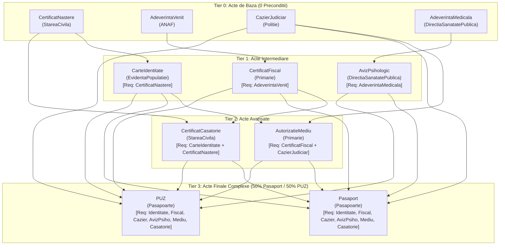
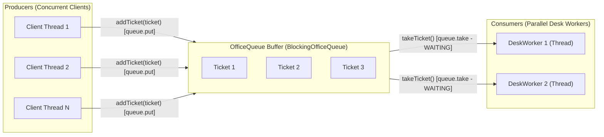
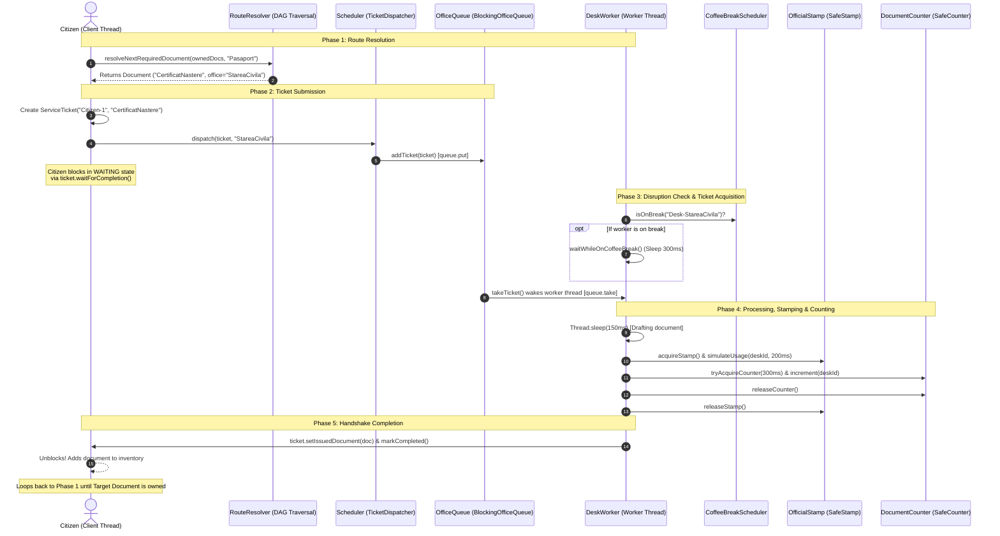
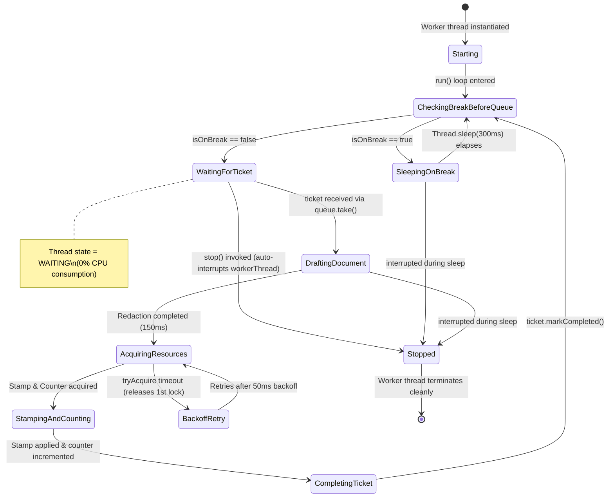
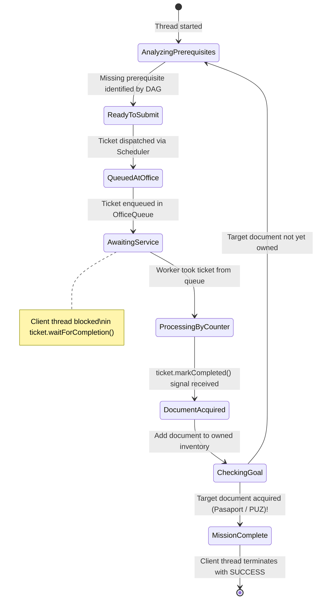
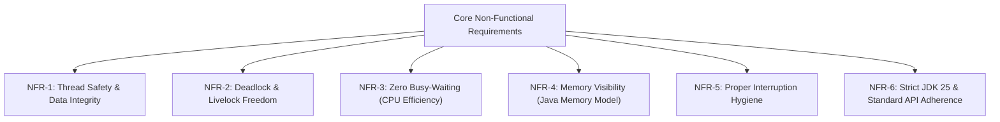
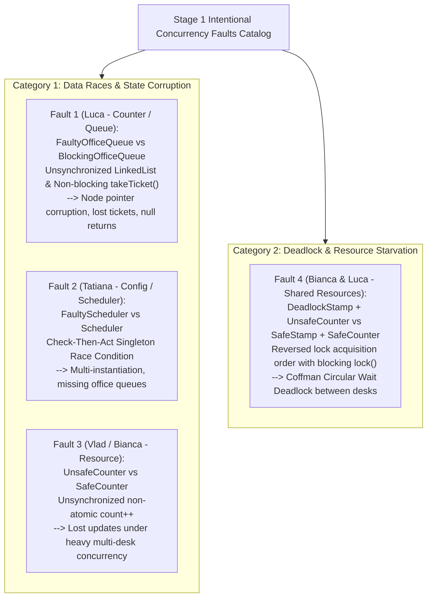
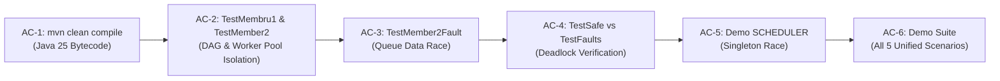

# Project Requirements Specification: Bureaucracy System Coordinator

**Course:** Concurrent and Event-Based Programming (CEBP / PCBE) — Year 4, Semester 1 (2026/2027)  
**Institution:** Politehnica University of Timișoara (UPT)  
**Faculty:** Faculty of Automatics and Computers, Department of Computer Science and Information Technology  
**Project Topic:** Bureaucratic System Coordinator (_Coordonator de Sistem Birocratic_) — Stage 1: Java Concurrency API  
**Target Environment:** Java SE 25 LTS (minimum Java 21 LTS), Apache Maven, Standard `java.util.concurrent` framework

---

## 1. Project Overview & Scope

The **Bureaucracy System Coordinator** is an end-to-end concurrent simulation modeling citizen navigation through an interdependent administrative institution. Real-world bureaucratic systems feature complex multi-counter waiting lines, strict document prerequisite chains, shared physical resources, and spontaneous disruptions (coffee breaks).

In strict adherence to the **Stage 1 (Java Concurrency API)** laboratory requirements, the project delivers:
1. **A Complete and Fully Functional Thread-Safe System:** Implemented exclusively with standard Java concurrency primitives (`LinkedBlockingQueue`, `ConcurrentHashMap`, `CompletableFuture`, `ReentrantLock(true)`, `ScheduledExecutorService`, `AtomicBoolean`, `volatile` flags, `CyclicBarrier`, `CountDownLatch`), eliminating busy-waiting, data races, and unhandled thread interruptions.
2. **At Least Two Deliberately Flawed Solutions (Intentional Concurrency Faults):** Implemented via **Polymorphic Dependency Injection (DI)** without modifying or breaking existing business logic:
   - **Category 1 (Data Races & Data Incoherence):**
     - *OfficeQueue :: FaultyOfficeQueue:* Unsynchronized `LinkedList` data race, corrupted internal node pointers, dropped tickets (*Lost Updates*), and non-blocking premature null returns.
     - *Scheduler :: FaultyScheduler:* Unsynchronized Check-Then-Act Singleton race condition causing multi-instantiation and split office queues.
     - *DocumentCounter :: UnsafeCounter + DeskWorkerUnsafe + UnsafeStamp:* Non-atomic `count++` operations and lock-free stamp access causing lost updates under high concurrent counter contention.
   - **Category 2 (Deadlock & Resource Starvation):**
     - *Shared Resources :: DeadlockStamp + UnsafeCounter:* Circular Wait Deadlock between concurrent counters acquiring resources in reverse order with uninterruptible blocking locks (`lock.lock()`), contrasted against safe deadlock avoidance using timed lock acquisition (`tryLock` timeout and backoff).

---

## 2. High-Level Architecture & 5-Layer Component Map

The software architecture is decoupled into 5 distinct modular layers communicating via thread-safe abstractions and Dependency Injection:

```mermaid
flowchart TD
    subgraph ClientLayer["1. Client Layer (Concurrent Citizen Threads)"]
        C1["Citizen 1..N (50% Target: Pasaport)"]
        C2["Citizen N+1..2N (50% Target: PUZ)"]
    end

    subgraph RoutingLayer["2. Routing & Knowledge Layer (4-Tier DAG)"]
        RR["RouteResolver (Thread-Safe Recursive DAG Traversal)"]
        DR["DocumentRegistry (ConcurrentHashMap Catalog - 11 Documents)"]
        RR <--> DR
    end

    subgraph DispatchLayer["3. Central Dispatcher Layer (TicketDispatcher Interface)"]
        SCH["Scheduler (DCL Singleton) / FaultyScheduler (Check-Then-Act Race)"]
    end

    subgraph OfficeLayer["4. Office & Counter Infrastructure (7 Offices / 10 Desks)"]
        O1["StareaCivila (1 Desk)"]
        O2["ANAF (2 Parallel Desks - Worker Pool)"]
        O3["Politie (1 Desk)"]
        O4["EvidentaPopulatiei (2 Parallel Desks - Worker Pool)"]
        O5["Primarie (1 Desk)"]
        O6["DirectiaSanatatePublica (1 Desk)"]
        O7["Pasapoarte (2 Parallel Desks - Worker Pool)"]
    end

    subgraph ResourceLayer["5. Shared Resources & Stochastic Disruptions"]
        STAMP["OfficialStamp (SafeStamp / UnsafeStamp / DeadlockStamp)"]
        CNT["DocumentCounter (SafeCounter / UnsafeCounter)"]
        CBS["CoffeeBreakScheduler (ScheduledExecutorService + DeskState Tokens)"]
    end

    C1 & C2 -->|"1. Query next prerequisite"| RR
    C1 & C2 -->|"2. Submit ServiceTicket"| SCH
    SCH -->|"3. Dispatch ticket to office queue"| O1 & O2 & O3 & O4 & O5 & O6 & O7

    O1 & O2 & O3 & O4 & O5 & O6 & O7 -.->|"Acquire / Release Stamp Mutex"| STAMP
    O1 & O2 & O3 & O4 & O5 & O6 & O7 -.->|"Acquire / Increment Counter"| CNT
    CBS -.->|"Inject Periodic Coffee Breaks"| O1 & O2 & O3 & O4 & O5 & O6 & O7
    O1 & O2 & O3 & O4 & O5 & O6 & O7 -->|"Asynchronous Completion Signal"| C1 & C2
```



---

## 3. Team Responsibilities & Ownership Matrix

| Team Member | Module & Package | Key Components | Concurrency Primitives & Techniques Utilized |
| :--- | :--- | :--- | :--- |
| **Tatiana Lazăr**<br>(Member 1) | `bureaucraticSystem.config` | `Document`, `DocumentRegistry`, `RouteResolver`, `TestMembru1`, `FaultyScheduler` | Defensive immutable `Set.copyOf`, `ConcurrentHashMap`, thread-confined DFS DAG traversal, circular dependency detection (`IllegalStateException`), and Singleton Check-Then-Act Race Condition demonstration (`FaultyScheduler`). |
| **Luca-Adrian Mihuț**<br>(Member 2) | `bureaucraticSystem.counter` | `OfficeQueue`, `BlockingOfficeQueue`, `FaultyOfficeQueue`, `DeskWorker`, `DeskWorkerSafe`, `DeskWorkerUnsafe`, `TestMember2`, `TestMember2Fault` | `LinkedBlockingQueue` (Producer-Consumer) vs unsynchronized `LinkedList` data race, Worker Pool parallel servicing, `volatile` memory visibility, self-interrupting graceful shutdown (`stop()`), polymorphic desk implementations (`DeskWorkerSafe` vs `DeskWorkerUnsafe`), and timeout-driven ticket safety. |
| **Vlad Iordăchescu**<br>(Member 3) | `bureaucraticSystem.client`<br>`bureaucraticSystem.scheduler`<br>`bureaucraticSystem.demo` | `Client`, `ServiceTicket`, `TicketDispatcher`, `Scheduler`, `FaultyScheduler`, `Demo` | Asynchronous ticket handshake via `CompletableFuture<Boolean>`, `ConcurrentHashMap.newKeySet()`, Double-Checked Locking Singleton, unified multi-scenario demo engine (`Demo.java`), and automated shell/PowerShell test harnesses (`run_all_demos.sh`, `run_all_demos.ps1`). |
| **Bianca Grovu**<br>(Member 4) | `bureaucraticSystem.resource` | `OfficialStamp`, `SafeStamp`, `UnsafeStamp`, `DeadlockStamp`, `DocumentCounter`, `SafeCounter`, `UnsafeCounter`, `CoffeeBreakScheduler`, `TestSafe`, `TestFaults` | Fair `ReentrantLock(true)` mutex, timed lock acquisition (`tryLock(timeout)`) with backoff vs circular-wait deadlock (`DeadlockStamp` with `lock.lock()`), non-locking `UnsafeStamp` for counter contention, and `ScheduledExecutorService` break injection with generation tokens. |

---

## 4. Dependency Injection Architecture (Safe vs. Faulty Implementations)

To seamlessly switch between fully thread-safe executions and intentional concurrency faults at runtime, the application defines 5 core contracts (interfaces and extensible base classes):

```mermaid
classDiagram
    class TicketDispatcher {
        <<interface>>
        +registerOffice(String, OfficeQueue)
        +unregisterOffice(String)
        +getOfficeQueue(String) OfficeQueue
        +dispatch(ServiceTicket, String)
        +dispatch(ServiceTicket)
        +stop()
        +isRunning() boolean
    }
    class Scheduler {
        <<Safe Implementation>>
        Double-Checked Locking Singleton with volatile instance
    }
    class FaultyScheduler {
        <<Faulty Implementation>>
        Unsynchronized Check-Then-Act causing multi-instantiation race
    }

    class OfficeQueue {
        +addTicket(ServiceTicket)
        +takeTicket() ServiceTicket
        +pollTicket(long, TimeUnit) ServiceTicket
        +size() int
        +isEmpty() boolean
        +clear()
    }
    class BlockingOfficeQueue {
        <<Safe Implementation>>
        LinkedBlockingQueue (Thread-Safe & Zero-CPU Blocking)
    }
    class FaultyOfficeQueue {
        <<Faulty Implementation>>
        LinkedList (Unsynchronized & Non-Blocking Null Return)
    }

    class OfficialStamp {
        <<interface>>
        +acquireStamp()
        +releaseStamp()
        +tryAcquireStamp(long) boolean
        +simulateUsage(String, long)
    }
    class SafeStamp {
        <<Safe Implementation>>
        ReentrantLock(true) + tryLock(timeout)
    }
    class UnsafeStamp {
        <<Faulty - Counter Contention>>
        Yields stamp immediately without lock to maximize concurrent counter access
    }
    class DeadlockStamp {
        <<Faulty - Deadlock>>
        Unconditional blocking lock.lock() ignoring timeout
    }

    class DocumentCounter {
        <<interface>>
        +acquireCounter()
        +releaseCounter()
        +tryAcquireCounter(long) boolean
        +increment(String) int
        +getCount() int
    }
    class SafeCounter {
        <<Safe Implementation>>
        ReentrantLock(true) + lock-protected increment
    }
    class UnsafeCounter {
        <<Faulty Implementation>>
        Non-atomic count++ & blocking tryAcquireCounter()
    }

    class DeskWorker {
        <<interface>>
        +getDeskId() String
        +stop()
        +isRunning() boolean
        +run()
    }
    class DeskWorkerSafe {
        <<Safe Implementation>>
        Synchronizes both Stamp and Counter with backoff retry
    }
    class DeskWorkerUnsafe {
        <<Faulty Implementation>>
        Calls increment() without acquiring Counter lock
    }

    TicketDispatcher <|.. Scheduler
    TicketDispatcher <|.. FaultyScheduler
    OfficeQueue <|-- BlockingOfficeQueue
    OfficeQueue <|-- FaultyOfficeQueue
    OfficialStamp <|.. SafeStamp
    OfficialStamp <|.. UnsafeStamp
    OfficialStamp <|.. DeadlockStamp
    DocumentCounter <|.. SafeCounter
    DocumentCounter <|.. UnsafeCounter
    DeskWorker <|.. DeskWorkerSafe
    DeskWorker <|.. DeskWorkerUnsafe

    DeskWorkerSafe --> OfficeQueue : injected via constructor
    DeskWorkerSafe --> OfficialStamp : injected via constructor
    DeskWorkerSafe --> DocumentCounter : injected via constructor
    DeskWorkerUnsafe --> OfficeQueue : injected via constructor
    DeskWorkerUnsafe --> OfficialStamp : injected via constructor
    DeskWorkerUnsafe --> DocumentCounter : injected via constructor
    Client --> TicketDispatcher : injected via constructor
```



---

## 5. Document Dependency Graph (DAG) Model

Documents cannot be obtained directly without satisfying prerequisite document trees. The institution models a **4-tier Directed Acyclic Graph** comprising **11 distinct registered documents** distributed across **7 administrative offices** (9 shared intermediate prerequisites across Tiers 0–2 plus 2 final target documents in Tier 3, so each citizen acquires **10 documents** in total):



### Shared Office Routing Guarantee
To maximize concurrency, lock contention, and queue pressure, **both target document paths (`Pasaport` and `PUZ`) require visiting all 7 administrative offices**:
1. `StareaCivila` (emits `CertificatNastere` & `CertificatCasatorie`)
2. `ANAF` (emits `AdeverintaVenit`)
3. `Politie` (emits `CazierJudiciar`)
4. `EvidentaPopulatiei` (emits `CarteIdentitate`)
5. `Primarie` (emits `CertificatFiscal` & `AutorizatieMediu`)
6. `DirectiaSanatatePublica` (emits `AdeverintaMedicala` & `AvizPsihologic`)
7. `Pasapoarte` (emits final `Pasaport` & `PUZ`)

---

## 6. Functional Requirements (FR)

### FR-1: Document Immutability & Registry
- **FR-1.1:** Documents (`Document`) are strictly immutable objects holding a unique document ID (`String`), issuing office ID (`String`), an immutable set of prerequisite document IDs (`Set<String>`), and an optional issuance tracking counter (`int intID`).
- **FR-1.2:** `DocumentRegistry` maintains the catalog backed by a `ConcurrentHashMap`. It provides both standard registration (`registerDocument`) and atomic check-then-insert (`registerIfAbsent` via `putIfAbsent`).

### FR-2: Recursive Route Resolution
- **FR-2.1:** `RouteResolver` dynamically determines the immediate next missing prerequisite for a client given their currently owned document set (`Set<String> ownedDocs`) and target document ID.
- **FR-2.2:** Recursive traversal is completely thread-confined (allocating local tracking sets on the stack) and throws `IllegalStateException` upon detecting circular dependencies.

### FR-3: Office Waiting Queues (Producer-Consumer Buffer)
- **FR-3.1:** Each office has an associated queue implementing the Producer-Consumer pattern.
- **FR-3.2:** In the safe implementation (`BlockingOfficeQueue`), `addTicket()` safely buffers tickets across multiple concurrent producers without pointer corruption, and `takeTicket()` suspends the worker thread in a zero-CPU `WAITING` state if the queue is empty.



### FR-4: Desk Workers & Worker Pools
- **FR-4.1:** Each service desk runs on an independent `Thread` executing a `DeskWorker` instance.
- **FR-4.2:** Offices with high traffic (`ANAF`, `EvidentaPopulatiei`, `Pasapoarte`) employ **Worker Pools** where 2 concurrent desk workers service the single shared queue without race conditions or duplicate ticket processing.
- **FR-4.3:** To prevent ticket starvation, a worker verifies active coffee breaks (`waitWhileOnCoffeeBreak()`) **before** invoking `queue.takeTicket()`, ensuring a desk on break does not withhold tickets that could be serviced by an active peer desk.
- **FR-4.4:** Calling `worker.stop()` sets `running = false` and automatically interrupts the worker's thread (`workerThread.interrupt()`), guaranteeing immediate unblocking from empty queues.
- **FR-4.5:** If processing fails or is interrupted unexpectedly, a `finally` block in `run()` guarantees `ticket.markFailed()` is called, ensuring the client thread is never left waiting indefinitely.

### FR-5: Client Request Lifecycle & Asynchronous Handshake
- **FR-5.1:** Citizens run on independent concurrent threads (`Client`), autonomously querying `RouteResolver` and submitting tickets until their target document is acquired.
- **FR-5.2:** Clients and desks communicate via `ServiceTicket`, backed by an encapsulated `CompletableFuture<Boolean>`. The client thread blocks efficiently (`waitForCompletion()`) without polling or spinning CPU cores.

### FR-6: Shared Institutional Resources (`OfficialStamp` & `DocumentCounter`)
- **FR-6.1:** Desks acquire exclusive access to shared resources through Dependency Injection.
- **FR-6.2:** The safe implementations (`SafeStamp`, `SafeCounter`) employ fair locks (`ReentrantLock(true)`) to prevent desk starvation, and use timed acquisitions (`tryAcquire` with 300ms timeout) combined with lock release and backoff (50ms retry) to guarantee deadlock freedom.

### FR-7: Stochastic Coffee Break Scheduling
- **FR-7.1:** `CoffeeBreakScheduler` schedules periodic desk interruptions using a `ScheduledExecutorService`.
- **FR-7.2:** To prevent overlapping tasks and race conditions, each desk state (`DeskState`) maintains an atomic generation token (`long generation`). When a break schedule is updated or stopped, the generation is incremented, immediately invalidating obsolete pending callbacks.

### FR-8: Central Dispatching & Graceful Shutdown
- **FR-8.1:** Centralized ticket routing is managed by `TicketDispatcher` (`Scheduler` / `FaultyScheduler`).
- **FR-8.2:** Upon simulation completion, all citizen threads are joined, desk workers are signaled to stop, scheduled executors are terminated (`shutdownAll()`), and all singleton states are cleanly reset without orphaned daemon processes.

---

## 7. End-to-End Sequence of Execution



---

## 8. State Machine Models

### Desk Worker Lifecycle:



### Client Thread Lifecycle:



---

## 9. Non-Functional & Concurrency Requirements (NFR)



- **NFR-1 (Thread Safety & Integrity):** All shared states (`DocumentRegistry`, `BlockingOfficeQueue`, `CoffeeBreakScheduler`, `SafeStamp`, `SafeCounter`) remain strictly thread-safe under concurrent operations.
- **NFR-2 (Deadlock Freedom):** In safe mode, multi-lock resource acquisition relies on `tryLock(timeout, TimeUnit.MILLISECONDS)`. If the secondary lock cannot be acquired within the timeout window, the primary lock is released in a `finally` block, breaking Coffman's *Hold and Wait* and *Circular Wait* conditions.
- **NFR-3 (Zero Busy-Waiting):** Waiting threads block via OS-level thread suspension (`queue.take()`, `future.get()`, `ct.join()`). No spinning `while (condition)` polling loops without timed sleep are allowed in production code.
- **NFR-4 (Memory Visibility):** Loop termination flags (`running`) and worker thread references (`workerThread`) are declared `volatile`, establishing formal *happens-before* relationships across CPU cores under the Java Memory Model (JMM).
- **NFR-5 (Interruption Hygiene):** When `InterruptedException` is caught, the interrupt status is restored via `Thread.currentThread().interrupt()`. Any active ticket is marked as failed (`ticket.markFailed()`), preventing orphaned waiting clients.
- **NFR-6 (Standard Platform):** Must compile and execute cleanly on Java SE 25 LTS using Apache Maven with zero external concurrency libraries.

---

## 10. Stage 1 Faulty Solutions (Intentional Concurrency Flaws Catalog)

The project implements **4 intentional concurrency faults** via Dependency Injection:



### Detailed Breakdown of Implemented Faults:

#### Fault 1: Member 2 (Luca) — Unsynchronized Queue (`FaultyOfficeQueue` vs. `BlockingOfficeQueue`)
- **Mechanism:** Replaces `LinkedBlockingQueue` with a raw `java.util.LinkedList<ServiceTicket>`. Its `takeTicket()` checks `if (unsafeList.isEmpty()) return null;` rather than blocking in `WAITING`.
- **Concurrency Issue:** `LinkedList` provides zero internal synchronization. When concurrent client threads invoke `addTicket()` and desk workers invoke `takeTicket()`:
  - Concurrent mutations to `last.next`, `first`, and `size` collide across CPU cores, corrupting internal node pointers, throwing `NoSuchElementException` / `IndexOutOfBoundsException`, or dropping tickets silently (*Lost Updates*) so clients hang indefinitely.
  - Desk workers polling an empty queue receive `null` immediately and spin in a tight `continue` loop (*Busy-Waiting*), burning CPU cycles instead of suspending in `WAITING`.
- **Validation:** Executed via `TestMember2Fault` or `Demo.java` with argument `QUEUE`.

#### Fault 2: Member 1 & Member 3 (Tatiana & Vlad) — Singleton Race Condition (`FaultyScheduler` vs. `Scheduler`)
- **Mechanism:** `FaultyScheduler.getInstance(registry)` performs a non-synchronized Check-Then-Act:
  ```java
  if (instance == null) {
      Thread.sleep(50); // Widens race window
      instance = new FaultyScheduler(registry);
  }
  ```
- **Concurrency Issue:** Concurrent threads simultaneously see `instance == null` and instantiate multiple distinct `FaultyScheduler` objects.
- **System Failure:** The setup thread registers office queues in Instance #1, while clients query Instance #2 (where all office queues are empty), causing tickets to fail immediately with `"Nu exista coada inregistrata pentru biroul: X"`.
- **Validation:** Executed via `Demo.java` with argument `SCHEDULER` (or `DemoVariant.RACE_CONDITION_SCHEDULER`).

#### Fault 3: Member 3 & Member 4 (Vlad & Bianca) — Non-Atomic Counter & Contention (`UnsafeCounter`, `DeskWorkerUnsafe`, `UnsafeStamp`)
- **Mechanism:**
  - In `UnsafeCounter`, the `increment()` operation performs unsynchronized `count++` (`read -> modify -> write`).
  - In `DeskWorkerUnsafe`, desk workers bypass lock acquisition entirely and invoke `documentCounter.increment(deskId)` directly.
  - In `UnsafeStamp`, the stamp yields access immediately without mutual exclusion, allowing multiple desks to proceed in parallel without being serialized at the stamp.
- **Concurrency Issue:** Under heavy concurrent load across 10 desks, simultaneous unsynchronized reads and writes to `count` overwrite each other, causing the recorded total document count to fall significantly below the actual documents serviced (*Lost Updates*).
- **Validation:** Executed via `Demo.java` with argument `COUNTER` (or `DemoVariant.RACE_CONDITION_COUNTER`).

#### Fault 4: Member 4 & Member 2 (Bianca & Luca) — Circular Wait Deadlock (`DeadlockStamp` + `UnsafeCounter`)
- **Mechanism:**
  - `Desk-ANAF-1` (`stampFirst = true`) acquires `DeadlockStamp` first, then requests `UnsafeCounter`.
  - `Desk-ANAF-2` (`stampFirst = false`) acquires `UnsafeCounter` first, then requests `DeadlockStamp`.
  - In `DeadlockStamp` and `UnsafeCounter`, the `tryAcquire...` methods ignore timeouts and execute unconditional, uninterruptible blocking `lock.lock()`.
- **Concurrency Issue:** Both desks hold their first lock and block indefinitely waiting for the lock held by the other desk (**Coffman Circular Wait Deadlock**). The entire institution freezes.
- **Safe Resolution:** In `SafeStamp` and `SafeCounter`, `tryAcquire` uses `lock.tryLock(300ms)`. When a timeout occurs, the desk releases its held lock in a `finally` block, waits 50ms (backoff), and retries, eliminating the deadlock completely.
- **Validation:** Executed via `TestFaults` (or `Demo.java` with argument `DEADLOCK`) vs `TestSafe` (safe mode). Controlled at runtime via the `deadlockGuardActive` toggle and CLI watchdog timeout.

---

## 11. Acceptance Criteria & Verification Pipeline



| ID | Verification Target | Procedure / Command | Acceptance Criteria |
| :--- | :--- | :--- | :--- |
| **AC-1** | Compilation | `mvn clean compile` | Zero errors on JDK 25 LTS. |
| **AC-2** | DAG & Worker Pool | `mvn exec:java -Dexec.mainClass="bureaucraticSystem.config.graph.TestMembru1"`<br>`mvn exec:java -Dexec.mainClass="bureaucraticSystem.counter.TestMember2"` | Concurrent DAG resolution resolves base prerequisite; 2 parallel desks process 4 queued tickets simultaneously with clean shutdown (`stop()`). |
| **AC-3** | Queue Data Race | `mvn exec:java -Dexec.mainClass="bureaucraticSystem.counter.TestMember2Fault"` | Demonstrates lost tickets on `FaultyOfficeQueue` vs 1000/1000 preserved tickets on `BlockingOfficeQueue`. |
| **AC-4** | Deadlock Resolution | `mvn exec:java -Dexec.mainClass="bureaucraticSystem.resource.TestSafe"` | `SafeStamp` + `SafeCounter` successfully completes all client documents without deadlock (vs `TestFaults` circular wait). |
| **AC-5** | Singleton Race | `java -cp target/classes bureaucraticSystem.demo.Demo SCHEDULER 20` | `FaultyScheduler` creates multiple instances with missing queues vs 1 instance on `Scheduler`. |
| **AC-6** | Unified Demo | `java -cp target/classes bureaucraticSystem.demo.Demo GOOD 10` | 10 concurrent citizens acquire `Pasaport` & `PUZ` across 7 offices, exactly 100 documents recorded in counter, 0 threads leaked. |

---

## 12. Unified Simulation & Demonstration Engine (`Demo.java`)

[`Demo.java`](../src/main/java/bureaucraticSystem/demo/Demo.java) orchestrates institutional assembly, dependency injection wiring, execution modes, and fault verification into a single executable engine.

### 12.1 Execution Modes (`DemoVariant` Enum)
- `ALL_DEMOS`: Executes all scenarios sequentially, intentionally keeping `DEADLOCK` last.
- `ALL_GOOD`: The full safe system (all components thread-safe; 100% completion).
- `RACE_CONDITION_SCHEDULER`: Triggers `FaultyScheduler` singleton multi-instantiation.
- `RACE_CONDITION_QUEUE`: Triggers `FaultyOfficeQueue` linked-list mutation race.
- `RACE_CONDITION_COUNTER`: Triggers `UnsafeCounter` lost updates race.
- `DEADLOCK`: Triggers circular-wait deadlock on shared stamp and counter.

### 12.2 Configuration Knobs & CLI Syntax
```bash
java -cp target/classes bureaucraticSystem.demo.Demo <MODE> [CLIENT_COUNT] [GUARD_ACTIVE] [TIMEOUT_SECONDS]
```
- **`<MODE>`:** `ALL` (`ALL_DEMOS`), `GOOD` (`ALL_GOOD`), `SCHEDULER` (`RACE_CONDITION_SCHEDULER`), `QUEUE` (`RACE_CONDITION_QUEUE`), `COUNTER` (`RACE_CONDITION_COUNTER`), `DEADLOCK` (defaults to build-time `selectedDemo = DemoVariant.ALL_GOOD`).
- **`[CLIENT_COUNT]`:** Number of concurrent citizen threads (defaults to build-time `DEFAULT_CLIENT_COUNT = 10000` in `Demo.java`, or `100` in the runner scripts).
- **`[GUARD_ACTIVE]`:** `true` (enables defensive deadlock timeout detection) or `false` (indefinite thread join).
- **`[TIMEOUT_SECONDS]`:** Custom watchdog timer in seconds (automatically activates deadlock guard).

### 12.3 Automated Script Execution
- **Linux / macOS:** `./run_all_demos.sh`
- **Windows PowerShell:** `.\run_all_demos.ps1`
